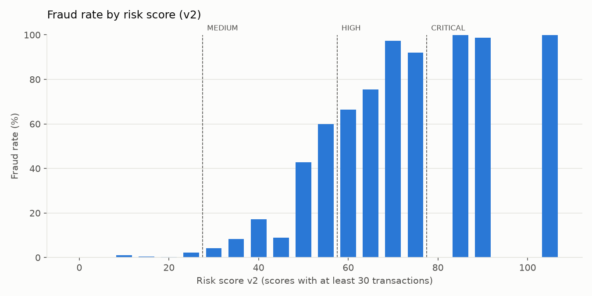

# Fraud Detection & Customer Risk Analytics

**English** | [Polski](README.pl.md)

Fraud analysis and a transparent, rule-based risk score built on **257,947 synthetic card transactions** (10,000 customers, 500 merchants, January–June 2026).
The goal: catch as much fraud as possible while keeping **false positives** low, and be able to explain every alert.

**Stack:** PostgreSQL 18 · Python (pandas, NumPy, matplotlib, psycopg) · Power BI

---

## Key results

| | |
|---|---|
| Fraud share of transactions | **1.64%** (4,242 of 257,947) |
| Fraud share of value | **14.65%** (EUR 3.43M of EUR 23.4M) |
| Average fraud vs normal transaction | EUR 808 vs EUR 79 |
| Abroad vs home country fraud rate | 10.14% vs 0.11% |
| Riskiest categories | crypto 18.97%, electronics 10.21%, gift cards 8.40% |

**Risk score v1 → v2 (threshold 60)**

| | v1 | v2 | change |
|---|---|---|---|
| False positives | 1,009 | **227** | **−78%** |
| Frauds detected | 1,821 | 1,742 | −4% |
| Precision | 64.3% | **88.5%** | +24 pp |

For comparison, a simple "amount above EUR 191.57" rule (IQR) raises 22,276 alerts and only **14.8%** of them are fraud.

**Recommendation:** two action levels instead of one threshold:
- **score 80+**: automatic block (466 transactions in 6 months, 99.1% fraud);
- **score 50–79**: manual review queue (about 21 cases a day, about 62% fraud).

Together they catch **66.8%** of all frauds.

## Strongest fraud signals

| Signal | Fraud rate when the signal fires | Lift |
|---|---|---|
| 5+ transactions in 10 minutes | 100%* | ×60.8 |
| New device (first 24 h) | 43.45% | ×26.4 |
| High-risk merchant category | 11.59% | ×7.0 |
| Amount > 3× customer's average | 9.55% | ×5.8 |
| First transaction in a new country | 8.01% | ×4.9 |
| Previous fraud / chargeback | 5.41% | ×3.3 |
| Night hours | 3.04% | ×1.9 |

\* An effect of synthetic data, see limitations.

The main lesson from the false positive analysis: the "customer history" rule was behind **96% of false alarms** in v1. Lowering its weight and raising the weight of "new device" removed almost 4 of 5 false alarms.



## Project structure

```
python/
  01-05, 07_generate_*.py    synthetic data generators (seed 42) -> data/*.csv
  06_load_to_postgres.py      loads the CSV files into PostgreSQL (COPY)
  08_eda.py                   exploratory analysis, charts
  09_anomaly_detection.py     IQR / z-score vs risk score, Power BI export
sql/
  00_create_tables.sql        star schema: 4 dimensions + 2 fact tables
  01_data_quality.sql         17 data quality checks
  02_sql_analysis/            fraud rate, trends, customer behaviour, window-function signals
  03_risk_scoring.sql         risk score v1 (7 signals, transaction and customer level)
  04_false_positives.sql      confusion matrix, thresholds, which rules cause false alarms
  05_risk_score_v2.sql        re-weighted risk score v2, before/after comparison
charts/                       charts from the Python scripts
docs/                         project summary (PDF), SQL notes, PostgreSQL vs T-SQL cheat sheet
```

**Data model (star schema):** `fact_transaction` with `dim_customer`, `dim_merchant`, `dim_device`, `dim_fx_rate` (daily EUR rates for 9 currencies), plus `fact_customer_risk`.

**SQL techniques used:** CTEs, window functions (`LAG`, `ROW_NUMBER`, `RANGE BETWEEN INTERVAL ... PRECEDING`), `FILTER`, `CROSS JOIN LATERAL`, multi-column joins for currency conversion, `CASE`-based scoring.

## How to run

1. Create a PostgreSQL database `fraud_project` and run `sql/00_create_tables.sql`.
2. Install Python packages: `pip install -r requirements.txt`.
3. Generate and load the data (run from the project root):
   `python/01` → `02` → `03` → `04` → `05` → `07` → `06_load_to_postgres.py`.
   The data is not stored in the repo. With seed 42 it is recreated identically.
4. SQL: `01_data_quality.sql`, the files in `02_sql_analysis/`, then `03_risk_scoring.sql` → `04_false_positives.sql` → `05_risk_score_v2.sql`.
5. Python: `08_eda.py` → `09_anomaly_detection.py` (also creates `powerbi_data/` for the dashboard).

The scripts ask for the PostgreSQL password in the terminal. No credentials are stored in the code.

## Limitations

- The data is **synthetic**. In a real bank the fraud label is delayed and incomplete.
- Some signals are "too clean" (5+ transactions in 10 minutes = 100% fraud; 5 categories with 0% fraud). This comes from the generator.
- The v2 weights were tuned and evaluated on the same period. In production they would be validated on a new, unseen period.
- The 30-day window and the 30/60/80 level thresholds are demonstration assumptions.

## Next steps

- New signals: password or phone change before a payment, new payee, impossible travel between countries.
- Compare the rule-based score with an ML model (logistic regression, decision trees).
- Power BI dashboard on `powerbi_data/`.

---

Author: Piotr Rudzki
